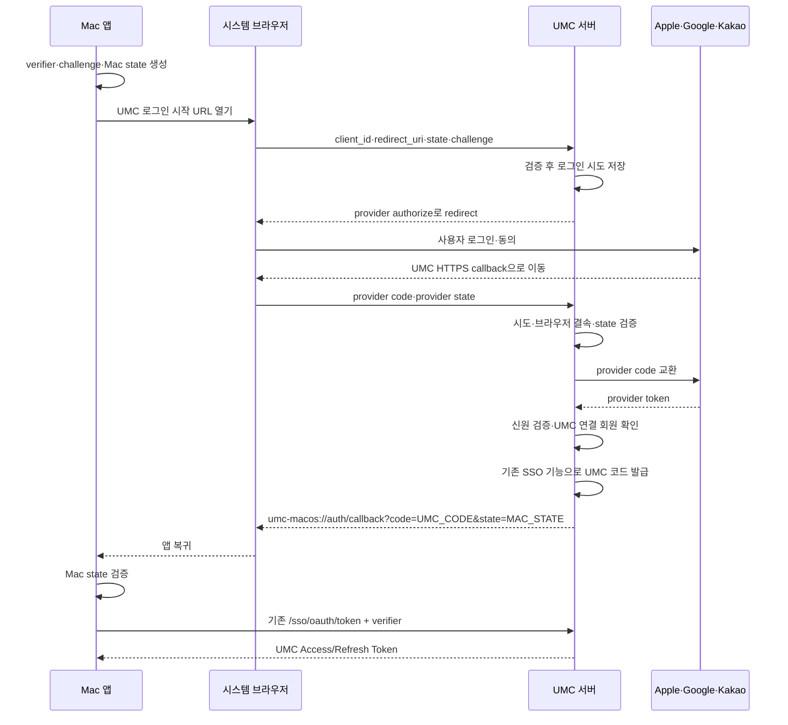

# 인증·인가 온보딩 및 macOS SSO 요구사항 검토

작성일: 2026-10-11 · 코드 확인 기준: `70e1085f`

> **구현 전 분석 기록**: 본문의 “현재 상태”, “필요한 변경”, “합의할 계약”은 위 커밋을 기준으로 작성했다. 이후 macOS 소셜 SSO가 구현되었으므로, 현재 동작·API·설정·검증 방법은 [macOS 소셜 SSO 개발 가이드](../onboarding/macos-social-sso.md)를 참고한다. 이 문서는 도메인 학습과 구현 전 검토 이력을 위해 보존한다.

이 문서는 인증·인가 기능을 처음 개발하는 담당자를 위한 저장소 분석이다. 사용자가 제공한 「공통 엔진 도메인 책임 범위 가이드」의 4번 인증·인가를 후속 작업의 책임 기준으로 삼는다. 아래에서 **현재 구현**, **이번 요구로 필요한 변경**, **합의가 필요한 정책**을 구별한다. 제안한 신규 API·클래스 이름은 확정된 계약이 아니다.

## 1. 개발 가능성과 일정 판단

현재 구조에서 개발할 수 있다. UMC 일회용 SSO 코드, PKCE S256, 코드의 해시 저장·일회성 소비, 토큰 교환, 클라이언트별 redirect 허용 목록이 이미 있다. 새로 필요한 핵심은 **서버가 소셜 로그인을 시작하고 제공자의 HTTPS 콜백을 받은 뒤 기존 SSO 발급으로 연결하는 부분**이다.

| 요구사항 | 현재 상태 | 필요한 일 |
| --- | --- | --- |
| Apple·Google·Kakao 로그인 시작 API | 해당 provider redirect 시작 기능을 기존 인증 컨트롤러에서 확인하지 못함 | 시작 요청 검증, 로그인 시도 저장, provider authorize URL 생성, 브라우저 redirect |
| 세 제공자 HTTPS 콜백 | 기존 소셜 SSO API는 JSON POST 로그인 API | provider별 콜백 입력·실패 처리, state 검증, 코드 교환, 회원 확인 |
| UMC 일회용 코드로 Mac 복귀 | 코드 발급·redirect 구성 존재 | 검증된 소셜 로그인 결과를 기존 SSO 발급으로 연결 |
| `macos-app`과 앱 복귀 URI | 미등록 | `app.sso.clients` 및 환경별 설정 추가 |
| `MACOS_APP` / `MACOS` | 현재 enum에 없음 | 서비스/플랫폼 분류, native 판정, 최초 발급·갱신·관측 반영 |
| Kakao 코드 교환 재사용 | 이미 구현 | HTTPS 콜백에서 공개 UseCase/Port를 통해 호출 |
| Google 코드 교환 | 기존 Google verifier는 ID/access token 검증 | 서버용 OAuth client 설정과 authorization code 교환 추가 |
| Apple 코드 교환 | 이미 구현하나 redirect URI 인자가 없음 | 웹 Services ID와 서버 callback URI를 사용하는 교환 경로 보완 |

기존 회원만 로그인하고, provider 콘솔·HTTPS 주소·자격증명이 준비되어 있으며, 리뷰와 Mac 연동 지원을 바로 받을 수 있다면 검토할 수 있다.

## 2. 담당 범위와 협업 경계

인증(Authentication)은 “이 요청을 보낸 사람이 누구인가”, 인가(Authorization)는 “그 사람이 이 작업을 해도 되는가”를 판단한다.

| 영역 | 인증·인가 담당 책임 | 협업 상대의 책임 |
| --- | --- | --- |
| 이메일·비밀번호 | 입력 정책, 해시 생성·검증, 본인 확인 | member: 회원·해시 저장과 변경 |
| 소셜 로그인 | provider 인증 검증, UMC 계정 연결, 연결/해제 정책 | member: 회원 생성·프로필·상태 |
| 이메일 인증 | 세션·코드·만료·시도·재발송·목적별 증명 토큰 | notification: 메일 구성·실제 전달·발송 실패 |
| JWT·SSO | 발급·검증·갱신·폐기, 쿠키, client/redirect/PKCE | 클라이언트: 안전한 저장·콜백 수신·state 확인 |
| 공통 보안 | Security Filter Chain, `@Public`, `@CurrentMember`, 공통 실패 응답 | 각 진입점 담당: REST·GraphQL·WebSocket의 연동 |
| 역할·권한 | 역할 조회/변경, 공통 판단, `@CheckAccess`, snapshot/cache | 제품 도메인: 업무상 허용 정책 합의·리소스 상태 변경 |
| SUPER_ADMIN | member 공개 Query UseCase로 조회하여 전역 권한에 반영 | member: `member_system_role` 저장 |
| 설정·운영 | 필요한 설정 계약·검증·보안 기록 지점 정의 | Infrastructure: 비밀값 공급·네트워크·TLS·배포, 콘솔 접근 담당: provider 등록 |
| 공통 Outbox | 인증 이벤트의 내용·발행 시점 | Messaging 공동 소유: 저장·폴링·재시도 기반 |

따라서 이번 macOS 요청의 서버 인증 흐름은 담당 범위에 들어간다. Mac 앱의 URL scheme 등록·브라우저 세션·Keychain 저장까지 서버 담당자가 전부 구현하는 것은 아니다. 신규 가입까지 요구되면 member·term·클라이언트 담당자와 범위를 함께 정한다.

책임 가이드에 나열된 기능을 모두 구현 완료로 해석하면 안 된다. 전체 기기 로그아웃·즉시 권한 회수·MFA는 별도 범위이며, 현재 비밀번호 재설정 메서드에서도 모든 토큰의 일괄 폐기를 확인할 수 없다.

## 3. 프로젝트를 읽는 기본 구조

```text
:app       실행·배포 JAR 조립, 모듈 조립 검증
:monolith  authentication, authorization, member, global 등 대부분의 도메인
:blog      분리된 blog 도메인
```

인증 코드는 `monolith/src/main/java/com/umc/product/authentication`, 인가 코드는 같은 루트의 `authorization`에 있다. 공통 보안은 `global/security`, 클라이언트 구분은 `global/client`, 플랫폼 enum은 `common/domain/enums/ClientType.java`에 있다.

```text
HTTP 요청
  → adapter/in/web의 Controller: 요청 형식·검증·응답/redirect 처리
  → application/port/in의 UseCase: 기능을 사용하는 공개 계약
  → application/service: 검증과 작업 순서 조합
  → domain: 데이터와 상태 변경 규칙
  → application/port/out: 저장·외부 통신에 필요한 계약
  → adapter/out: JPA/QueryDSL 또는 소셜 제공자 HTTP 호출
```

다른 도메인의 데이터는 해당 도메인의 공개 UseCase로 요청한다. 인증 서비스에서 member repository를 바로 주입하면 안 된다. 기존 코드에 경계가 넓은 컨트롤러가 있어도 새 callback에서 provider verifier나 repository를 직접 호출하는 패턴을 복사하지 않는다.

Command 서비스는 트랜잭션으로 상태를 변경하고, Query 서비스는 read-only 트랜잭션으로 조회한다. Controller에서 받은 Request는 adapter 경계에서 Command/Query로 바꾸고, 응답은 Response 또는 Info를 사용한다.

## 4. 코드·토큰·state를 먼저 구별하기

| 이름 | 발급자 | 용도/사용처 |
| --- | --- | --- |
| provider authorization code | Apple·Google·Kakao | UMC 서버가 제공자 토큰과 교환하는 코드 |
| provider ID Token | 소셜 제공자 | 서명·issuer·audience 등을 검증해 소셜 계정 확인 |
| provider Access/Refresh Token | 소셜 제공자 | 제공자 API·세션에 사용. UMC API 토큰과 별개 |
| UMC SSO authorization code | UMC 서버 | Mac이 UMC `/sso/oauth/token`에서 교환하는 짧은 일회용 코드 |
| UMC Access Token | UMC 서버 | `Authorization: Bearer ...`로 UMC API 호출 |
| UMC Refresh Token | UMC 서버 | Access Token 재발급. 서버 allow-list와 대조 |
| `UMC_SSO_LOGIN` 쿠키 | UMC 서버 | Auth App 브라우저 로그인 상태. 일반 회원 API의 Bearer 인증과 구별 |
| `oAuthVerificationToken` | UMC 서버 | 소셜 계정 확인이 끝났다는 가입/연결용 증명. 로그인 완료와 구별 |
| `emailVerificationToken` | UMC 서버 | REGISTER/CHANGE_EMAIL/PASSWORD_RESET 목적별 이메일 인증 증명 |

`macos-app`은 **UMC SSO에 등록하는 client ID**다. Google의 OAuth client ID, Kakao REST API 키, Apple Services ID는 제공자별 별도 식별자다. 이들을 같은 문자열로 바꾸거나 서로 대신 넣지 않는다.

PKCE에서는 Mac이 난수 `code_verifier`를 생성해 보관하고, `BASE64URL(SHA256(verifier))`인 `code_challenge`를 시작 요청에 보낸다. UMC는 코드에 challenge를 묶고, 최종 교환 때 verifier가 맞는지 검사한다. 코드만 가로챈 다른 앱은 verifier 없이 토큰을 받을 수 없도록 하는 장치다.

state도 두 구간을 구분한다. Mac이 만든 state는 Mac→UMC→Mac 요청을 연결하고 Mac이 검증한다. UMC가 제공자에 보낸 state는 UMC→제공자→UMC 콜백을 연결하고 UMC가 검증한다. 서버가 임의 redirect URI·PKCE 정보를 state 문자열에서 그대로 신뢰해서는 안 된다.

## 5. 현재 인증 기능의 실제 흐름

### 5.1 이메일·비밀번호

`CredentialAuthenticationController` → `CredentialAuthenticationUseCase` → `CredentialAuthenticationService` 순서다. `SsoCredentialVerifier`가 member의 `GetMemberCredentialUseCase`로 해시를 조회하고 `PasswordEncoder`로 검증한다. 성공하면 `AuthenticationTokenIssuer`가 토큰을 발급하고 Refresh Token의 jti를 저장한다.

`SecurityConfig`의 PasswordEncoder는 신규 Argon2와 기존 bcrypt 검증을 지원한다. `CredentialRehashService`는 로그인 성공 시 기존 해시의 업그레이드를 맡는다. 비밀번호 저장 자체는 `ManageMemberCredentialUseCase`로 member에 요청한다.

### 5.2 기존 소셜 직접 로그인

`AuthenticationController`는 `/api/v1/auth/login/google`, `/login/kakao`, `/login/apple`, `/login/kakao/code`를 제공한다. Google·Kakao는 이미 받은 ID/access token을 보낼 수 있고 Apple은 authorization code와 ClientType을 보낸다.

`VerifyOAuthTokenPort` → `OAuthTokenVerificationAdapter` → 제공자별 Verifier가 외부 인증 정보를 검증한다. `OAuthAuthenticationService.loginWithOAuthAttributes()`는 **provider + providerId**로 연결된 UMC 계정을 찾는다. 같은 이메일만으로 자동 연결하는 로직이 아니다.

연결된 계정이면 UMC 토큰을 발급한다. 연결된 계정이 없으면 `oAuthVerificationToken`을 반환해 가입/연결을 이어가게 한다. “UMC 회원가입을 한 사람”이라도 선택한 소셜 계정이 연결되지 않았다면 이 분기가 중요하다.

Google·Kakao·Apple의 ID Token 검증과 JWKS 공개키 캐시는 현재 구현되어 있다. OAuth/OIDC Backlog의 과거 상태 설명을 그대로 현재 상태로 읽으면 안 된다.

### 5.3 이메일 인증

`EmailAuthenticationController` → `AuthenticationService` → `EmailVerification` 흐름이다. 현재 엔티티에는 6자리 코드, 10분 세션, 최대 5회 시도, 30초 재발송 간격이 있다. 틀린 코드의 시도 횟수도 저장되도록 검증 메서드는 `noRollbackFor`를 사용한다.

인증 목적은 REGISTER·CHANGE_EMAIL·PASSWORD_RESET으로 구별한다. 비밀번호 재설정 요청에서는 계정 존재 여부를 응답으로 쉽게 추측하지 못하도록 실제 메일 발송만 생략하는 흐름이 있다.

인증 도메인은 `SendVerificationEmailEvent`를 발행하고 listener가 notification의 `SendEmailUseCase`에 위임한다. 세션 저장·이벤트 처리·실제 메일 수신은 각각 확인해야 한다. Outbox 저장만으로 수신 성공을 보장하지 않는다.

### 5.4 현재 웹 SSO

1. Auth App이 `/api/v1/auth/sso/email` 또는 소셜 POST API를 호출한다.
2. 기존 연결 회원이면 `SsoBrowserLoginCommandService`가 브라우저 로그인 토큰을 만들고 `SsoCookieWriter`가 HttpOnly 쿠키를 기록한다.
3. `/api/v1/auth/sso/oauth/authorize`가 쿠키·등록 client·정확한 redirect URI·PKCE S256을 검증한다.
4. `SsoAuthorizationCommandService`가 난수 코드를 만들고 SHA-256 해시만 DB에 저장한다. 기본 코드 TTL 설정은 3분이다.
5. `code`와 `state`를 붙여 등록된 클라이언트 callback으로 redirect한다.
6. 클라이언트가 `/api/v1/auth/sso/oauth/token`에 form-urlencoded로 교환 요청을 보낸다.
7. `SsoTokenExchangeCommandService`가 코드 해시를 비관적 잠금으로 읽고 사용 여부·만료·client·redirect·verifier를 검사해 토큰을 발급한다.

현재 `/sso/kakao`, `/sso/google`은 **소셜 로그인 화면으로 보내는 시작 API가 아니다.** 이미 받은 토큰을 받아 브라우저 로그인 상태를 만드는 POST API다. `/sso/apple`도 Apple의 외부 form callback을 그대로 받는 API와 구별해야 한다.

### 5.5 갱신·로그아웃·연결 해제

`POST /api/v1/auth/token/renew`는 Refresh JWT를 파싱하고 DB의 jti·회원·client·만료를 검사한 뒤 기존 jti를 삭제하고 새 토큰으로 교체한다. SSO client가 있으면 등록 설정의 client context와 Access Token TTL을 다시 사용한다.

현재 이 SSO 갱신 분기는 `AuthenticationTokenIssuer.issue(..., null, clientContext, ttl)`을 호출한다. 따라서 최초 토큰의 `clientType`을 갱신 후에도 유지하려면 보완해야 한다. client context 유지와 ClientType 유지는 같은 의미가 아니다.

`POST /api/v1/auth/logout`은 전달한 Refresh Token의 jti를 allow-list에서 삭제한다. 이미 발급된 stateless Access Token의 즉시 폐기나 전체 기기 로그아웃을 의미하지 않는다. `/sso/logout`은 브라우저 쿠키 삭제라는 별도 동작이다.

`MemberOAuthController`와 `OAuthAuthenticationService`는 소셜 연결·조회·해제를 맡는다. 비밀번호 credential이 없는 회원은 마지막 소셜 로그인 수단을 제거할 수 없다. member 공개 UseCase의 row lock 뒤에 개수를 확인해 동시 해제를 직렬화한다. provider측 revoke는 보유 토큰 등 조건에 따라 수행되므로 로컬 연결 삭제와 제공자 연결 해제의 보장 범위를 구분한다.

## 6. 현재 인가와 공통 보안

일반 회원 REST 요청에서는 `JwtAuthenticationFilter`가 Bearer 토큰을 검증하고 `MemberPrincipal`을 SecurityContext에 넣는다. `@CurrentMember` resolver는 여기서 회원 정보를 전달한다. `@Public`은 공개 진입점을 수집하게 하며, `SecurityConfig`가 나머지 요청의 인증을 요구한다. 데모데이 게스트 쿠키 등 별도 인증 경로도 있으므로 전체 서비스를 회원 JWT 하나로 단순화하지 않는다.

```text
@CheckAccess
  → AccessControlAspect
  → CheckPermissionUseCase / AuthorizationService
  → member·challenger·organization 공개 조회 + 역할 조회
  → SubjectAttributes / AuthoritySnapshot
  → ResourceType에 맞는 ResourcePermissionEvaluator
  → 허용 또는 거절
```

Evaluator는 authorization 폴더 안에만 있지 않다. project, organization, schedule, community, member, blog 등 리소스를 소유한 도메인에도 있다. 공통 체계는 인증·인가 담당이 관리하지만 업무상 허용 정책은 해당 담당자와 합의한다.

새 역할 읽기에는 `ListChallengerRoleUseCase`, boolean 판단에는 `CheckChallengerAuthorityUseCase`를 사용한다. `GetChallengerRoleUseCase`는 호환 facade로 남아 있다. boolean 권한 판단은 먼저 전용 회원 존재 Query UseCase로 없는 회원을 거절한다.

리소스에 기수가 있으면 ChallengerRole 판단은 해당 기수의 `...InGisu(...)`를 사용한다. 의도적으로 전역인 `...InAnyGisu(...)`의 기존 동작을 리팩터링 중 임의로 좁히지 않는다. `SUPER_ADMIN`은 member에 저장된 전역 예외이며 ChallengerRole에 다시 추가하면 안 된다.

`AuthorizationService`의 snapshot 캐시는 현재 Caffeine 기반 인스턴스 로컬이며 TTL은 30초다. 엔티티 대신 버전 있는 DTO를 직렬화한다. 역할 변경 후에는 `EvictAuthoritySnapshotCacheUseCase`로 commit 이후 무효화한다. 여러 서버 전체의 즉시 회수를 보장하는 구조는 아니다.

프론트엔드의 권한 조회 API는 버튼 노출에 활용할 수 있다. 서버는 실제 업무 API에서도 인가를 수행해야 한다.

| 진입점 | 함께 볼 곳 | 담당자가 알아야 할 점 |
| --- | --- | --- |
| REST | SecurityConfig, JwtAuthenticationFilter, CurrentMemberArgumentResolver | 공개 여부·회원 인증·리소스 인가가 각각 다른 단계 |
| GraphQL | global/config/GraphQl*, 각 GraphQL Controller, GraphQlExceptionAdvice | `/graphql` 자체가 열려 있어도 resolver별 인증·인가가 필요 |
| WebSocket | StompPrincipalInterceptor, StompAuthChannelInterceptor, 소비 도메인 authorizer | CONNECT 토큰 인증과 SEND/SUBSCRIBE 권한은 별도 |
| 관측·실패 | ApiAuthenticationEntryPoint, ApiAccessDeniedHandler, GlobalExceptionHandler, LoggingInterceptor | filter 오류와 MVC 오류의 처리 위치가 다름 |

## 7. 요청받은 macOS 흐름을 구현 단위로 풀기



이 다이어그램의 callback 이동은 개념 흐름이다. Apple은 요청한 response mode에 따라 POST form callback이므로 GET으로만 구현하면 안 된다.

### 7.1 시작 API

예시 경로는 `GET /api/v1/auth/sso/social/{provider}/authorize`다. 입력은 provider, `client_id=macos-app`, `redirect_uri=umc-macos://auth/callback`, Mac state, code challenge, `code_challenge_method=S256`이다. 실제 경로는 클라이언트와 계약한다.

서버는 외부 사이트로 보내기 전에 등록 client·정확한 앱 복귀 URI·state 형식·PKCE를 검증한다. provider callback URI는 요청자가 임의로 고르는 값보다 서버 설정의 고정 HTTPS 주소를 사용한다.

검증된 Mac 요청 정보와 provider state를 저장한다. provider 로그인 후 되돌아왔을 때 처음의 client·redirect·PKCE challenge를 복구해야 하기 때문이다. 로그인 시도는 TTL, 일회성 소비, provider 구분, 브라우저 결속을 갖춰야 한다. DB 또는 원자적 consume이 가능한 저장소를 선택한다. 일반 캐시 get/evict만으로 일회성을 보장했다고 간주하지 않는다.

### 7.2 HTTPS 콜백

예시 경로는 `/api/v1/auth/sso/social/{provider}/callback`이다. Google·Kakao의 GET callback과 Apple의 form POST callback을 제공자 명세에 맞게 구분한다. “HTTPS callback”은 브라우저가 해당 서버 주소로 결과를 전달한다는 뜻이며 항상 provider 서버의 직접 서버 간 호출은 아니다.

callback은 provider state·저장된 시도·만료·사용 여부·요청을 시작한 브라우저와의 연결을 검사한다. callback 경로의 provider와 저장된 provider가 다르면 거부한다. OpenID Connect nonce를 보냈다면 반환된 ID Token에서도 해당 nonce를 검증하도록 Port 입력을 확장한다.

검증 이후 provider code를 교환하고 기존 소셜 계정 매칭을 호출한다. 그 다음 기존 SSO 코드 발급으로 연결한다. 실패하거나 신뢰할 시도를 찾지 못하면 callback의 임의 redirect URI로 사용자를 보내지 않는다.

### 7.3 기존 SSO와 연결

현재 authorize 서비스는 검증할 raw 브라우저 로그인 토큰을 입력받는다. 기존 브라우저 로그인 service에서 소셜 검증 결과로 로그인 정보를 생성하는 경로를 확장하고, 그 결과를 application 계층에서 SSO authorize에 전달하는 방법을 우선 검토할 수 있다. 필요하면 공통 코드 발급 부분을 추출하되 memberId를 외부 요청에서 그대로 받아 발급하는 공개 우회 API를 만들지 않는다.

서버 내부 서비스 연결을 위해 컨트롤러끼리 호출하거나 같은 서버에 불필요한 HTTP 요청을 보내지 않는다. 로그인 쿠키를 유지할지도 명시적으로 정하되, Mac으로 전달하는 URL에는 UMC 코드와 state만 사용한다. 최종 Access/Refresh Token은 기존 token API 응답으로 받는다.

### 7.4 제공자별 차이

**Kakao:** `OAuthAuthenticationService.authorizationCodeLogin()` → `VerifyOAuthTokenPort.verifyAuthorizationCode()` → `KakaoTokenVerifier.verifyAuthorizationCode()`를 재사용한다. callback HTTPS 주소를 Kakao 콘솔과 서버 `allowed-redirect-uris` 양쪽에 등록한다. 현재 교환 결과에 id_token이 있으면 OIDC 검증, 없으면 access token 사용자 조회를 사용한다.

**Google:** 현재 `GoogleTokenVerifier`는 ID/access token 검증을 제공하지만 authorization code 교환은 없다. 서버용 web OAuth client ID·secret·고정 callback URI를 설정하고 code를 token으로 교환한 뒤 기존 ID Token 검증을 재사용한다. 기존의 audience 허용 client 목록만으로 secret·교환 설정까지 준비된 것은 아니다. [Google 공식 서버 OAuth 문서](https://developers.google.com/identity/protocols/oauth2/web-server).

**Apple:** `AppleTokenVerifier`의 기존 code 교환과 ES256 client secret 생성·ID Token 검증을 재사용할 수 있다. 현재 메서드에는 redirect URI 입력이 없고 token 요청에도 들어가지 않는다. 이번처럼 시작 요청에 HTTPS redirect URI를 쓰면 동일한 URI를 교환 요청에 넣는 경로가 필요하다. [Apple token validation](https://developer.apple.com/documentation/signinwithapplerestapi/generate-and-validate-tokens?changes=l_1).

이번 Apple 인증은 브라우저 기반이므로 Apple Services ID를 사용하는 경로로 설계한다. 최종 UMC 토큰의 플랫폼이 MACOS라는 사실과 Apple의 provider client ID 선택은 별개다. 기존 iOS Bundle ID 경로와 섞지 않는다. 기존 회원의 Apple refresh token·발급 client ID 보관도 유지한다.

### 7.5 Apple 쿠키·CORS 확인

기본 SSO 쿠키 설정은 SameSite=Lax, 현재 SecurityConfig는 CORS를 적용하고 CSRF를 비활성화한다. 외부 사이트에서 돌아오는 Apple form POST에서 Lax 쿠키가 따라올 것이라고 전제하면 안 된다. callback이 Origin을 포함하면 현재 CORS 설정에 따라 filter 단계에서 거절될 가능성도 확인해야 한다.

필요하면 별도 짧은 correlation cookie를 설계하거나 안전한 중간 처리 뒤 같은 사이트 GET에서 시도를 확정하는 방식을 검토한다. callback 전용 CORS 처리는 해당 경로로 제한한다. 기존 보안 전체의 origin 허용을 넓히는 것으로 해결하지 않는다. 이 부분은 실제 브라우저 요청으로 검증해야 하며 현재 설정값만으로 운영 장애를 단정하지 않는다.

### 7.6 macOS 등록과 분류

```yaml
# 검토용 예시. 환경별 issuer·environment·TTL을 합의해 반영한다.
app:
  sso:
    clients:
      macos-app:
        name: UMC macOS App
        service-type: MACOS_APP
        environment: PROD
        require-pkce: true
        access-token-ttl: PT1H
        redirect-uris:
          - umc-macos://auth/callback
        allowed-origins: []
```

현 native client와 같은 방식으로 origin 목록을 비울 수 있지만, 현재 native 판정은 IOS_APP/ANDROID_APP만 허용하므로 MACOS_APP을 추가해야 한다. URI는 prefix가 아니라 등록 문자열 전체로 비교하는 기존 정책을 유지한다.

`ClientServiceType.MACOS_APP`은 사용 서비스, `ClientType.MACOS`는 토큰의 플랫폼 값이다. `ClientDeviceType`은 현재 DESKTOP 등으로 관측한다. 기기 통계도 MACOS로 별도 집계할지는 추가로 정하되, 필요한 경우 enum과 classifier를 함께 바꾼다. Mac의 웹 브라우저 요청까지 모두 macOS 앱으로 분류하면 안 된다.

갱신 시에는 등록된 SSO client service type에서 ClientType을 복원하는 등 최초 발급·갱신에 공통 매핑을 적용해야 한다. 사용자 입력 헤더를 신뢰해 서비스 권한을 부여하지 않는다. ClientType을 늘리면 `AppleOAuthProperties.resolveClientId()`의 exhaustive switch도 처리해야 한다.

## 8. 수정 파일 지도

아래 경로의 공통 루트는 `monolith/src/main/java/com/umc/product/`다.

| 파일/영역 | 변경 목적 |
| --- | --- |
| 신규 authentication/adapter/in/web 소셜 시작·callback Controller/DTO | GET 시작 redirect, provider별 callback 입력, 오류·앱 복귀 응답 |
| 신규 application/port/in UseCase와 application/service | 로그인 시도 시작·완료, 검증 순서, 기존 회원/가입 필요 분기 |
| 신규 로그인 시도 domain·out Port·persistence adapter | Mac 요청 정보·provider state·브라우저 결속·nonce·TTL·일회성 소비 |
| authentication/application/port/out/VerifyOAuthTokenPort.java | Google code 교환 및 Apple callback URI/nonce 검증 계약 확장 |
| authentication/adapter/out/external/OAuthTokenVerificationAdapter.java | 제공자별 새 code 흐름 연결 |
| authentication/adapter/out/external/GoogleTokenVerifier.java, GoogleOAuthProperties.java | 서버 code 교환과 자격증명 설정 |
| authentication/adapter/out/external/AppleTokenVerifier.java, AppleOAuthProperties.java | 웹 callback용 redirect URI와 provider client 매핑 |
| authentication/adapter/out/external/KakaoTokenVerifier.java, KakaoOAuthProperties.java | 기존 교환 재사용, callback 허용 URI 설정·필요한 검증 확장 |
| authentication/application/service/SsoBrowserLoginCommandService.java | 검증된 provider 결과를 기존 SSO 로그인으로 연결 |
| authentication/application/service/SsoAuthorizationCommandService.java | MACOS_APP native 판정, 기존 코드 발급 재사용 |
| authentication/application/service/SsoTokenExchangeCommandService.java | MACOS_APP→MACOS 최초 발급 매핑 |
| authentication/application/service/AuthenticationService.java | 갱신 시 MACOS ClientType 유지 |
| global/client/ClientServiceType.java, common/domain/enums/ClientType.java | MACOS_APP/MACOS 추가 |
| global/client/ClientRequestClassifier.java, 필요 시 ClientDeviceType.java | 서비스·플랫폼 관측 |
| global/config/SecurityConfig.java, SecurityPathConfig.java | callback 공개 여부·CORS·점검 경로 확인 |
| main/resources/application.yml 및 환경별 설정 | macos client, provider callback/credential 계약 |
| main/resources/db/migration의 신규 SQL | 로그인 시도를 DB 저장할 경우. 기존 적용 migration 수정 금지 |
| authentication/domain/exception/AuthenticationErrorCode.java | 필요 오류 추가 및 자동 에러 카탈로그 반영 |
| 기존 SSO 문서·OpenAPI·인증 관련 테스트 | macOS 경로와 웹/모바일 기존 계약 보존 확인 |

새 Gradle 모듈 생성은 이 요구의 필수 작업이 아니다. 기존 authentication 내부에서 확장할 수 있다. macos client 등록 자체도 현재 설정 기반이므로 SSO client 테이블을 새로 만드는 작업이 아니다.

## 9. 구현 전에 합의할 계약

| 항목 | 합의가 필요한 이유 | 초기 범위를 좁히는 선택 |
| --- | --- | --- |
| 기존 연결 회원만 지원할지 | 소셜 인증 성공만으로 UMC 회원 생성이 끝나지 않음 | 1차는 기존 연결 회원 로그인 |
| 신규/미연결 회원 응답 | 기존은 가입용 토큰 JSON 반환, 새 흐름은 앱 redirect | 앱에서 가입 필요를 처리할 안전한 오류/후속 흐름 합의 |
| 가입 후 로그인 복귀 | 기존 가입에는 이메일 인증·학교·약관 등이 필요 | 회원가입 UX는 별도 범위로 명시 |
| 시작 API 입력·callback 계약 | Mac이 verifier/state를 생성·검증해야 함 | 기존 token endpoint와 form 계약 유지 |
| 취소·실패·만료 | 브라우저에 JSON만 표시하면 Mac은 대기할 수 있음 | 검증된 시도에 대해서만 안전한 앱 오류 복귀 |
| 환경별 client·HTTPS 주소 | 콘솔 등록과 code 교환 URI가 정확히 같아야 함 | dev/prod 주소를 먼저 확정 |
| 브라우저 SSO 상태 유지 | Mac 로그인 뒤 다른 웹 서비스에도 로그인할지 | 기존 브라우저 쿠키 정책과 제품 기대를 명시 |
| 동시 로그인·재시도 | 한 Mac/여러 창에서 state를 덮어쓰지 않아야 함 | 시도별 독립 state·만료·일회성 처리 |

신규 가입을 지원할 경우 가입 증명 토큰이나 provider refresh token을 그대로 앱 복귀 URL에 붙이는 것으로 급히 해결하지 않는다. 서버에 검증 결과를 보관하고 제한된 후속 교환 등 계약을 따로 설계한다. 같은 이메일로 계정을 자동 병합하는 정책도 이번 요구에서 추론하면 안 된다.

## 10. Mac 담당자와 나누는 작업

Mac 담당자는 브라우저 인증 세션 시작, `umc-macos` scheme 처리, verifier/state 생성·임시 보관, callback state 검증, UMC token 교환, Keychain 저장·갱신·로그아웃·오류 UX를 맡는다.

“macOS에는 SDK가 없어서 전부 자체 구현해야 한다”는 전제는 정확하지 않다. macOS에는 `ASWebAuthenticationSession` 같은 시스템 브라우저 인증 기능이 있다. provider별 SDK 지원과 별개로 이번 서버 중계 흐름에 사용할 수 있다. [Apple ASWebAuthenticationSession](https://developer.apple.com/documentation/authenticationservices/aswebauthenticationsession).

외부 브라우저와 PKCE를 사용하는 native 인증 방식은 표준에 부합하는 방향이다. 제안받은 `umc-macos` scheme을 바꿀 필요는 요구사항 합의로 판단하되, RFC는 소유 도메인을 역순으로 한 scheme을 권고한다. scheme 소유만으로 앱을 인증했다고 간주하지 않고 PKCE를 유지한다. [RFC 8252](https://www.rfc-editor.org/rfc/rfc8252.html).

## 11. 참고 문서의 읽기 순서

| 순서 | 문서 | 읽으며 확인할 것 |
| --- | --- | --- |
| 1 | docs/onboarding/domain/authentication.md | 인증이 소유하는 것과 member 경계 |
| 2 | docs/onboarding/sso-authentication-flow.md | 현재 cookie→authorize→code→token 흐름 |
| 3 | docs/adr/001-apple-signin-client-type-routing.md | Apple Bundle ID/Services ID/audience/revoke |
| 4 | docs/adr/007-extend-kakao-login-with-authorization-code.md | 재사용할 Kakao code 교환과 redirect 허용 목록 |
| 5 | docs/onboarding/domain/authorization.md | 인가 공통 진입점과 evaluator |
| 6 | docs/onboarding/domain/authorization-operational-safety.md | 기수·SUPER_ADMIN·캐시·배포 제약 |
| 7 | docs/adr/017-email-as-login-identifier.md | 이메일 로그인·가입·credential 저장 |
| 8 | docs/adr/025-oauth-unlink-local-credential-invariant.md | 마지막 로그인 수단·동시 해제·member 잠금 |
| 9 | docs/onboarding/test/authentication.md, authorization.md, global.md, member.md | 테스트 위치와 실패 시나리오. 최신 케이스는 소스로 확인 |
| 10 | docs/onboarding/api-rate-limiter.md | 공개 로그인 API의 반복 요청 제한과 관측 |
| 11 | docs/adr/021-global-cache-usecase-and-cache-namespace.md | 공통 캐시 계약 |
| 12 | docs/guides/P6Spy_SQL_로그_보안_정책.md, docs/adr/016-structured-json-logging-with-mdc.md | code·token·인증번호 로그 비노출 |

협업 때문에 다음 문서도 함께 본다: member·challenger·organization·notification·term·audit 도메인 온보딩, `event-outbox-flow.md`, GraphQL 온보딩, Community WebSocket 계약, 프로젝트 권한 정책, SSM 설정 가이드, Flyway 런북, ADR-030 모듈 분리.

### 문서와 코드가 다를 때

- `docs/backlog/OAuth_OIDC_통합_전환_계획.md`는 과거 Backlog 초안이다. 현재는 Google/Kakao ID Token·JWKS 캐시와 Apple revoke client ID 전달이 이미 구현된 부분이 있다. 전체 전환 계획을 이번 macOS 기능의 선행 작업으로 삼지 않는다.
- Kakao code ADR의 Status는 Proposed이지만 실제 code 로그인은 구현돼 있다. Accepted/Proposed만으로 현재 제공 기능을 판단하지 않는다.
- 오래된 문서의 `src/main/java/...`는 현재 `monolith/src/main/java/...`로 찾아야 하는 경우가 있다. 실행 명령도 현재 `:app:bootRun`을 기준으로 한다.
- 테스트 카탈로그의 파일 수·케이스 수·과거 SUPER_ADMIN 표현은 최신 구현과 다를 수 있다. 현재 테스트 소스와 root AGENTS 규칙을 함께 본다.
- Outbox 과거 feature flag·rollback 설명은 현 publisher 고정 결정 및 코드와 비교한다. 이메일 도착까지 보장한다고 확대 해석하지 않는다.

## 12. 구현·검증 순서

1. 기존 SSO 성공/실패 테스트를 읽고 Mac의 기존 회원/가입 필요·취소 계약을 확정한다.
2. MACOS_APP/MACOS·macos client 설정·최초 발급/갱신 분류를 작은 변경으로 검증한다.
3. provider 로그인 시도 저장·state·브라우저 결속·callback 일회성 처리를 구현한다.
4. Kakao 교환을 먼저 재사용해 시작→callback→UMC code→token 전체 경로 하나를 완성한다.
5. Google code 교환과 Apple HTTPS/form POST 처리를 추가한다.
6. 실패·재시도·동시성·기존 웹/모바일 계약을 검증한다.
7. dev HTTPS에서 실제 Mac과 세 제공자를 연동하고 문서·콘솔·비밀값·배포 설정을 맞춘다.
8. 완료 기준은 저장소의 단일 명령 `./gradlew check`로 확인한다. 이 명령에는 테스트·포맷·정적 검사·migration 버전·문서 카탈로그 검증이 포함된다.

테스트를 참고할 파일:

- `SsoAuthorizationCommandServiceTest`: client/redirect/origin·PKCE·코드 해시 저장.
- `SsoTokenExchangeCommandServiceTest`: 코드 교환·만료·일회성·client/redirect·verifier.
- `SsoOAuthControllerAuthorizeTest`, `SsoOAuthControllerTokenTest`: HTTP 계약.
- `SsoFlowIntegrationTest`: 기존 브라우저 SSO→authorize→token 연결. 외부 OAuth와 JWT 일부는 mock이므로 실제 provider E2E로 해석하지 않는다.
- `AuthenticationServiceTest`: Refresh allow-list·회전·client context 유지.
- `KakaoTokenVerifierTest`, `GoogleTokenVerifierTest`, `AppleTokenVerifierTest`: 외부 교환/서명·audience 등 provider 검증.
- `SsoAuthorizationCodePersistenceAdapterTest`: 코드 저장·잠금 경로.
- `ClientRequestClassifierTest`: 플랫폼/서비스 관측 분류.

새로 필요한 검증에는 등록되지 않은 client/redirect, 없는·틀린·만료된·재사용된 provider state, provider 혼동, 다른 브라우저로 옮긴 시도, 로그인 취소, 신규/미연결 계정, 외부 실패, Apple form POST/CORS/cookie, UMC 코드 중복 교환, 틀린 verifier, 최초·갱신 후 MACOS 유지가 포함된다. 인증 성공 케이스만으로 완료 판정하지 않는다.

## 13. 요청자에게 전달할 검토 답변 예시

> 현재 UMC SSO + PKCE를 재사용해서 개발할 수 있어요. UMC 일회용 코드 발급·교환과 카카오 인가 코드 교환은 이미 있고, 서버 소셜 로그인 시작·HTTPS 콜백·로그인 요청 state 보관을 추가하면 됩니다. Google은 서버 인가 코드 교환을 추가하고, Apple은 웹 callback URI와 form POST 처리를 보완해야 해요. macos-app 등록과 MACOS_APP/MACOS 구분은 최초 발급뿐 아니라 갱신까지 반영하겠습니다. 기존 연결 회원만 지원하는 1차 범위와 콘솔 설정이 준비되면 1주 MVP는 검토할 수 있지만, 신규 가입·취소/실패·전체 회귀·실제 Mac 연동까지 포함하면 2주 정도로 잡는 게 안전해요. 먼저 신규/미연결 회원 처리, dev/prod callback 주소, 실패 시 앱 복귀 계약을 확정하면 작업 범위를 정할 수 있습니다.

## 14. 조사 범위와 한계

`docs`의 기존 120개 파일 전체 목록·목차를 확인하고 인증·인가 관련 본문과 코드를 대조했다. ADR/infra 28개는 본문 전체 검토를 마쳤다. 다른 문서군은 관련 본문·도메인 경계·테스트 카탈로그를 중심으로 확인했으며, 모든 문장·예제의 정확성까지 감사한 것으로 간주하지 않는다. 전체 정독을 나눈 보조 작업 일부는 실행 한도로 종료되어 그 결과를 완료로 집계하지 않았다.

실제 provider 콘솔, 운영 비밀값, 운영 DB, 실제 Mac 앱은 확인하지 않았다. 이번 작업은 구현 가능성·온보딩 분석이며 기능 코드 수정·로그인 실험·Gradle 테스트 실행은 포함하지 않았다. 따라서 개발 가능 판단을 현재 운영에서 즉시 동작한다는 보장으로 읽으면 안 된다.
