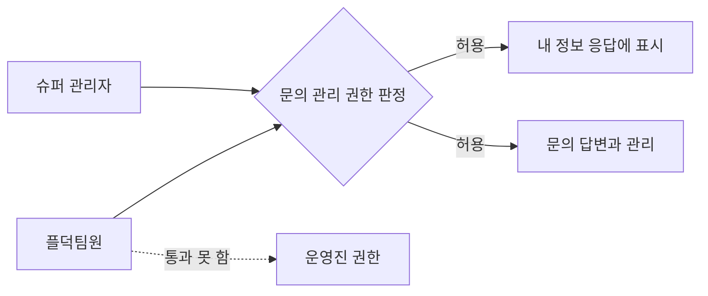

## 개요

PR 제목, PR 본문, 리뷰 코멘트를 쓰는 기준입니다. 사람과 AI 에이전트가 같이 씁니다.

형식을 다 지켜도 읽기 어려운 PR이 있습니다. #1495는 표와 그림을 모두 갖췄지만, 코드 이름을 알아야 읽을 수 있습니다.
이 문서는 코드를 모르는 팀원도 첫 문단만 읽고 무엇이 바뀌는지 알 수 있게 쓰는 방법을 정합니다.

리뷰의 우선순위(P1~P5)와 처리 절차는 [`코드_리뷰_기준.md`](코드_리뷰_기준.md)에 있습니다.

## 쓰는 규칙

아래 예시는 실제 PR에서 가져왔습니다. "고친 글"은 이 기준에 맞춰 다시 쓴 것입니다.

### 1. 첫 문장

**첫 문장에는 코드 말고 누구에게 무엇이 바뀌는지 적는다.**

- 원래 글(#1527): `StartingLineSeedService`: 출발선의 기본 정보 단계(UPDATE_INFO)에서 PO마다 다른 링크를 넣습니다.
- 고친 글: dev 매칭 리허설의 프로젝트 관리 화면에서 꺼져 있던 "기획 보기" 버튼을 누를 수 있습니다.

### 2. 제목

**제목만 읽어도 결론을 알 수 있게 쓴다.**

- 원래 글(#1495): [Feat] 문의 답변용 시스템 역할 UMC_PRODUCT와 member/me isUmcProduct 추가
- 고친 글: [Feat] 슈퍼 관리자 권한 없이 문의 답변 권한만 줄 수 있게 하기

리뷰 지적의 제목도 같습니다. #1490의 "이 마이그레이션이 PROD에 적용되면 이전 이미지로 롤백했을 때 앱이 뜨지 않습니다"는 제목만 읽어도 무슨 일이 생기는지 알 수 있습니다.

### 3. 사람에게 부탁할 일

**사람에게 부탁할 일은 `봐 주세요:`로 분명히 적는다.**

- 원래 글(#1495 표의 한 칸): SUPER_ADMIN은 AUTHZ-02 전역 override대로 문의도 관리. 판정은 authorization에만 두고 다음 문의 PR의 evaluator도 `AuthoritySnapshot.isUmcProduct()`를 씀
- 고친 글: `봐 주세요:` 슈퍼 관리자도 문의를 관리할 수 있게 두었습니다. 이렇게 둘지 정해 주세요.

부탁할 일이 없으면 없다고 적습니다.

### 4. 코드 이름

**코드 이름은 찾을 때 필요한 것만, 문장 뒤쪽에 적는다.**

- 원래 글(#1495): 역할 값은 `MemberSystemRoleType`·`SystemRoleType`과 CHECK 제약 마이그레이션, 판정은 `AuthoritySnapshot.isUmcProduct()`·`ChallengerRoleQueryService.isUmcProduct()`, 응답은 `MemberSummaryV2Response`입니다.
- 고친 글: 내 정보 응답에 문의를 관리할 수 있는지 알려 주는 값이 추가됩니다(`MemberSummaryV2Response`). 판정은 권한 도메인 한 곳에서 합니다(`AuthoritySnapshot`).

### 5. 표

**표 칸에는 짧은 말만 넣고, 설명이 길면 문단으로 푼다.**

원래 글(#1495):

| 영역 | 위험 | 봐줄 것 |
|---|---|---|
| API 계약 | 🔴 판단 필요 | member/me v2 최상위에 `isUmcProduct` 추가. SUPER_ADMIN도 true인 "문의 관리 가능 여부"라는 뜻. iOS `Codable`, Android Gson 모두 모르는 키는 무시 |

고친 글:

| 영역 | 위험 | 봐줄 것 |
|---|---|---|
| API 응답 | 🔴 판단 필요 | 새 값의 뜻 |

내 정보 응답에 새 값이 추가됩니다. 슈퍼 관리자도 이 값이 참입니다. iOS와 Android는 모르는 값을 무시하므로 지금 앱은 그대로 동작합니다.

### 6. 그림

**그림 라벨은 사람 말로 쓰고, 7칸 이하로 하고, 흐름이나 구조가 바뀔 때만 넣는다.**

원래 글(#1495의 일부):

```text
row["member_system_role 행<br/>UMC_PRODUCT"] --> judge{"isUmcProduct 판정<br/>(authorization)"}
```

고친 글:



#1527처럼 시딩 데이터의 빈칸을 채우는 변경은 흐름이 그대로이므로 그림을 넣지 않습니다.

### 7. 긴 근거

**SQL, 로그, 전체 검증 결과는 `<details>`로 접는다.**

- 원래 글(#1495): 부여·회수는 배포가 끝난 뒤 SQL(`INSERT INTO member_system_role (created_at, updated_at, member_id, role_type) VALUES (now(), now(), :memberId, 'UMC_PRODUCT')` / `DELETE ... WHERE member_id = :memberId AND role_type = 'UMC_PRODUCT'`)로 합니다.
- 고친 글: 역할 부여와 회수는 배포가 끝난 뒤 SQL로 합니다.

<details>
<summary>부여와 회수 SQL</summary>

```sql
INSERT INTO member_system_role (created_at, updated_at, member_id, role_type)
VALUES (now(), now(), :memberId, 'UMC_PRODUCT');

DELETE FROM member_system_role
WHERE member_id = :memberId AND role_type = 'UMC_PRODUCT';
```

</details>

### 8. 리뷰 지적

**리뷰 지적은 문제의 코드가 보이는 곳에 달고, 그 코드의 무엇이 왜 문제인지, 언제 터지는지, 어떻게 고칠지 순서로 쓴다. 문제없다고 확인한 긴 목록은 접는다.**

`파일:줄`을 글자로만 적으면 읽는 사람이 코드를 찾아가야 합니다. 지적은 코드 바로 옆에 있어야 합니다.

원래 글(umc-product-infra#79의 전체 코멘트):

> **P3: 서버 배포 전에 머지하면 런북의 인증 확인 요청이 404를 받는다**
> 위치: `docs/runbooks/cafe24-migration.md:191`
> 상황: 지금 prod 이미지는 Swagger UI가 꺼져 있다. 익명 요청은 Traefik에서 401을 받아 통과하지만, `--user` 요청은 404를 받아 이전 실패처럼 보인다.

고친 글(191번 줄의 줄 코멘트. GitHub가 이 줄을 코멘트 바로 위에 보여 줍니다):

> **[P3] 서버 배포 전에 머지하면 이 확인 명령이 404를 받아 이전 실패처럼 보입니다**
>
> 이 줄이 부르는 Swagger UI 주소가 지금 prod 이미지에는 없습니다. 익명 요청은 Traefik에서 401을 받아 통과한 것처럼 보이고, `--user`를 붙이면 404를 받습니다. 404는 이미지 설정과 파일 목록에서 추정한 결과입니다.
>
> 서버 변경이 prod에 배포된 뒤 머지해 주세요.

#1490의 지적도 같은 순서입니다.

> **[P3] 이 마이그레이션이 PROD에 적용되면 이전 이미지로 롤백했을 때 앱이 뜨지 않습니다**
>
> 테이블이 지워진 뒤 직전 이미지로 롤백하면 Hibernate validate가 부팅을 실패시킵니다. 이 PR과 무관한 이유로 롤백하는 경우에도 같습니다.
>
> PR 본문 "되돌리기"와 릴리스 메모에 "이번 릴리스 이후 이전 이미지로 롤백할 때는 `JPA_DDL_AUTO=none`으로 띄운다"를 적어 두면 됩니다.

같은 PR의 리뷰 본문은 문제없다고 확인한 항목 다섯 개를 펼쳐 두었습니다. 이런 목록은 접습니다.

```markdown
<details>
<summary>확인했고 문제없는 것 5건</summary>

- 지운 이름과 경로가 레포 어디에도 남아 있지 않습니다.
- (생략)

</details>
```

## 리뷰 코멘트 모양

리뷰 하나의 맨 위에는 리뷰어 이름과 우선순위별 개수 표를 둡니다. 지적이 없어도 남기므로, 리뷰가 돌았는지 바로 알 수 있습니다.

```markdown
🐛 버그·보안 리뷰어

| P1 | P2 | P3 | P4 | P5 |
|---|---|---|---|---|
| 0 | 0 | 1 | 1 | 0 |
```

- **줄 코멘트**: 바뀐 줄의 지적은 문제의 줄에 줄 코멘트로 답니다. 첫 줄은 `**[P3][ARCH-05] 제목**`이고, 규칙 번호가 없으면 `[P3]`만 씁니다.
- **바뀐 줄 밖의 지적**: 리뷰 본문의 표 아래에 적고, 제목 아래에 커밋을 고정한 링크를 한 줄로 넣습니다. GitHub가 코드 조각으로 보여 줍니다. 브랜치 이름 링크는 코드가 바뀌면 다른 줄을 가리키므로 쓰지 않습니다.
- **특정 줄이 없는 지적**: 빠진 테스트나 머지 순서는 가장 가까운 코드나 변경 파일을 가리키고 그렇다고 적습니다.
- **바로 고칠 수 있는 지적**: 줄 코멘트에 GitHub `suggestion` 블록을 넣습니다. 이 블록은 코멘트를 단 줄을 통째로 바꾸므로, 바꾼 뒤의 줄 전체를 적습니다.
- **그림**: 호출 순서나 상태 전이가 문제일 때만 Mermaid를 넣습니다.

바뀐 줄 밖의 지적은 이렇게 적습니다.

```markdown
**[P5] 온보딩 테스트 문서의 합계가 맞지 않습니다**

https://github.com/UMC-PRODUCT/umc-product-server/blob/<커밋 SHA>/docs/onboarding/test/README.md#L21

이 줄의 Organization 행은 32파일 168케이스인데, `organization.md`는 25파일 148케이스입니다. 이 줄을 25와 148로 고쳐 주세요.
```

줄 코멘트에 바로 고칠 내용을 넣으면 이렇게 됩니다.

````markdown
**[P4] `btree_gist` 확장을 남긴 이유가 적혀 있지 않습니다**

다음에 이 파일을 읽는 사람이 확장을 지워도 되는지 알 수 없습니다. 이유를 주석 한 줄로 남겨 주세요.

```suggestion
-- ADR-006 UMC PRODUCT 조직 모델 폐기. 코드와 API는 같은 변경에서 제거했다.
-- btree_gist 확장은 남긴다. 확장 삭제는 DB 권한에 따라 실패할 수 있고, 남겨도 동작에 영향이 없다.
```
````

## AI 리뷰 결과의 위치

AI 리뷰 결과는 PR 본문에 쓰지 않습니다. GitHub 리뷰와 코멘트에만 남깁니다.

- 원래 글(#1527의 `리뷰 중점사항`): PR 전에 독립 리뷰(pstack thermo-nuclear)를 돌렸습니다. P1~P3는 없었습니다.
- 고친 글: 이 문장을 지웁니다. 사람이 판단할 일만 `봐 주세요:`로 적습니다.

본문은 사람이 무엇을 볼지 정하는 곳이고, 리뷰 결과는 타임라인에서 지적마다 처리 기록이 쌓이는 곳에 있어야 합니다.
