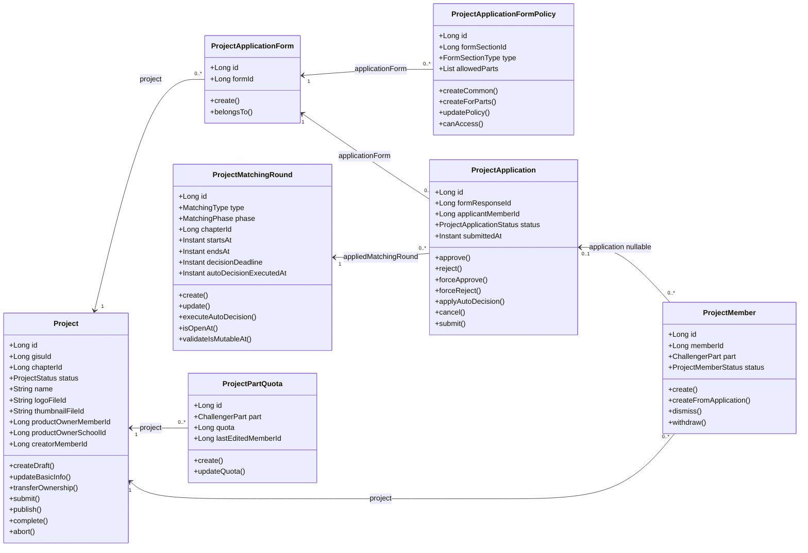
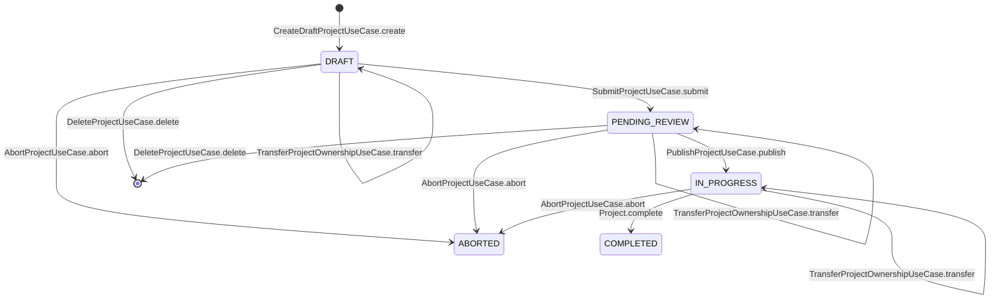
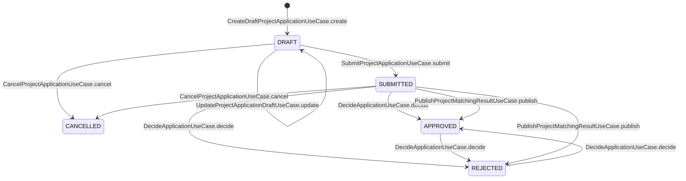

# Project Domain

## 빠른 구조 다이어그램

### Entity 관계

`project` 도메인의 외부 도메인 참조는 Aggregate 직접 참조가 아니라 ID 참조로 유지한다. 예를 들어 `Project.gisuId`, `Project.chapterId`, `Project.productOwnerMemberId`, `Project.productOwnerSchoolId`, `ProjectApplicationForm.formId`, `ProjectApplication.formResponseId`, `ProjectMember.memberId`가 그 경계다.

### 상태 전이와 핵심 Action

발표 시각이 있는 차수는 자동 선발에서 `PENDING_PUBLICATION` 멤버를 생성하고, 지원서 상태는 발표 작업에서 반영한다. 발표 시각이 없는 기존 차수는 자동 선발 시 지원서 상태도 즉시 반영한다.

### Command UseCase 지도

```mermaid
flowchart TB
  subgraph InAdapter["adapter/in"]
    ProjectCommandController["ProjectCommandController"]
    ProjectApplicationController["ProjectApplicationController"]
    ProjectApplicationFormController["ProjectApplicationFormController"]
    ProjectMatchingRoundController["ProjectMatchingRoundController"]
    MatchingRoundDeadlineHandler["MatchingRoundDeadlineHandler"]
    MatchingResultPublicationHandler["MatchingResultPublicationHandler"]
  end

  subgraph CommandService["application/service/command"]
    ProjectCommandService["ProjectCommandService"]
    ProjectApplicationCommandService["ProjectApplicationCommandService"]
    ProjectApplicationFormCommandService["ProjectApplicationFormCommandService"]
    ProjectPartQuotaCommandService["ProjectPartQuotaCommandService"]
    ProjectMemberCommandService["ProjectMemberCommandService"]
    ProjectMatchingRoundCommandService["ProjectMatchingRoundCommandService"]
    ProjectMatchingRoundFinalizationCommandService["ProjectMatchingRoundFinalizationCommandService"]
    ProjectMatchingResultPublicationCommandService["ProjectMatchingResultPublicationCommandService"]
  end

  subgraph UseCaseAction["port/in/command -> domain action"]
    ProjectLifecycle["Create/Update/Submit/Transfer/Publish/Complete/Delete/Abort Project<br/>Project.createDraft, updateBasicInfo, submit, publish, complete, abort"]
    ApplicationLifecycle["Create/Update/Submit/Cancel/Decide Application<br/>ProjectApplication.create, submit, cancel, approve, reject"]
    ApplicationFormUpsert["UpsertProjectApplicationFormUseCase.upsert<br/>Survey Form diff + ProjectApplicationFormPolicy sync"]
    QuotaMember["UpdatePartQuotas, AddProjectMember, RemoveProjectMember<br/>ProjectPartQuota.create/updateQuota, ProjectMember.create/dismiss"]
    MatchingRoundLifecycle["Create/Update/Delete MatchingRound<br/>ProjectMatchingRound.create/update + 선발·발표 예약"]
    MatchingRoundFinalize["AutoDecideProjectMatchingRoundUseCase.autoDecide<br/>선발·랜덤 매칭 + PENDING_PUBLICATION 멤버 생성"]
    MatchingResultPublish["PublishProjectMatchingResultUseCase.publish<br/>지원서 합불 반영 + ACTIVE로 변경 + 공개 완료 기록"]
  end

  ProjectCommandController --> ProjectCommandService
  ProjectCommandController --> ProjectPartQuotaCommandService
  ProjectCommandController --> ProjectMemberCommandService
  ProjectApplicationController --> ProjectApplicationCommandService
  ProjectApplicationFormController --> ProjectApplicationFormCommandService
  ProjectMatchingRoundController --> ProjectMatchingRoundCommandService
  ProjectMatchingRoundController --> ProjectMatchingRoundFinalizationCommandService
  MatchingRoundDeadlineHandler --> ProjectMatchingRoundFinalizationCommandService
  MatchingResultPublicationHandler --> ProjectMatchingResultPublicationCommandService

  ProjectCommandService --> ProjectLifecycle
  ProjectApplicationCommandService --> ApplicationLifecycle
  ProjectApplicationFormCommandService --> ApplicationFormUpsert
  ProjectPartQuotaCommandService --> QuotaMember
  ProjectMemberCommandService --> QuotaMember
  ProjectMatchingRoundCommandService --> MatchingRoundLifecycle
  ProjectMatchingRoundFinalizationCommandService --> MatchingRoundFinalize
  ProjectMatchingResultPublicationCommandService --> MatchingResultPublish

  ProjectLifecycle --> ProjectPorts["Load/SaveProject*, Load/SaveApplicationForm*, Load/SavePartQuota*, Load/SaveMember* Port"]
  ApplicationLifecycle --> ApplicationPorts["Load/SaveProjectApplication*, LoadMatchingRound, LoadPartQuota, LoadProjectMember Port"]
  ApplicationFormUpsert --> SurveyCommand["survey ManageForm/Section/Question/Option UseCase"]
  MatchingRoundFinalize --> MatchingPolicy["MatchingDecisionPolicy<br/>DesignerMatchingPolicy / DeveloperMatchingPolicy"]
```

### Query UseCase 지도

```mermaid
flowchart TB
  subgraph QueryController["adapter/in query"]
    ProjectQueryController["ProjectQueryController"]
    ProjectApplicationQueryController["ProjectApplicationQueryController"]
    ProjectApplicationFormControllerQ["ProjectApplicationFormController"]
    ProjectPermissionController["ProjectPermissionController"]
    ProjectStatisticsQueryController["ProjectStatisticsQueryController"]
    ProjectMatchingRoundControllerQ["ProjectMatchingRoundController"]
  end

  subgraph QueryService["application/service/query"]
    ProjectQueryService["ProjectQueryService<br/>GetProject, SearchProject, SearchManagedProject"]
    ProjectApplicationQueryService["ProjectApplicationQueryService<br/>GetMyApplications, GetApplicationDetail, SearchApplications"]
    ProjectApplicationFormQueryService["ProjectApplicationFormQueryService<br/>GetProjectApplicationForm"]
    ProjectMatchingRoundQueryService["ProjectMatchingRoundQueryService<br/>GetProjectMatchingRound"]
    ProjectMemberQueryService["ProjectMemberQueryService<br/>GetRandomMatchedProjectMember"]
    ProjectPermissionQueryService["ProjectPermissionQueryService<br/>GetProjectPermissions"]
    ProjectStatisticsQueryService["ProjectStatisticsQueryService<br/>GetProjectStatistics"]
  end

  ProjectQueryController --> ProjectQueryService
  ProjectQueryController --> ProjectMemberQueryService
  ProjectApplicationQueryController --> ProjectApplicationQueryService
  ProjectApplicationFormControllerQ --> ProjectApplicationFormQueryService
  ProjectPermissionController --> ProjectPermissionQueryService
  ProjectStatisticsQueryController --> ProjectStatisticsQueryService
  ProjectMatchingRoundControllerQ --> ProjectMatchingRoundQueryService

  ProjectQueryService --> ProjectReadPorts["LoadProject, LoadProjectMember, LoadProjectPartQuota Port"]
  ProjectApplicationQueryService --> ApplicationReadPorts["LoadProjectApplication, LoadApplicationForm, LoadPolicy Port"]
  ProjectApplicationFormQueryService --> FormReadPorts["LoadApplicationForm, LoadPolicy Port"]
  ProjectMatchingRoundQueryService --> RoundReadPorts["LoadProjectMatchingRound Port"]
  ProjectMemberQueryService --> MemberReadPorts["LoadProjectMember Port"]
  ProjectPermissionQueryService --> PermissionEval["ProjectPermissionEvaluator"]
  ProjectStatisticsQueryService --> StatisticsPort["LoadProjectStatistics Port"]

  ProjectReadPorts --> CrossDomainQuery["storage/member/challenger/survey/organization 공개 Query UseCase로 응답 조립"]
  ApplicationReadPorts --> CrossDomainQuery
  FormReadPorts --> CrossDomainQuery
  StatisticsPort --> CrossDomainQuery
```

## 역할

`project` 도메인은 프로젝트 생성, 제출, 공개, 팀원 관리, 지원서, 지원 폼, 매칭 차수와 자동 선발 정책을 관리한다.

## 책임

- 프로젝트 초안 작성부터 공개까지 상태 전이를 관리한다.
- 프로젝트 PO, Sub-PO, 팀원을 관리한다.
- 지원 폼과 지원서를 생성, 임시저장, 제출, 평가한다.
- 매칭 차수와 파트별 정원, 자동 선발을 관리한다.

## 지원서 합/불 결정과 자동 선발 후보

PM은 `PATCH /api/v1/projects/{projectId}/applications/{applicationId}/decision`으로 지원서 상태를 바꾼다. 요청 DTO의 `ApplicationDecisionStatus`는 `APPROVED`, `REJECTED`, `SUBMITTED` 세 값을 받는다. `SUBMITTED`는 이미 내린 합격·불합격을 거두고 대기(미판정)로 되돌리는 입력이며, 지원 현황 화면이 "대기"로 보여주는 값과 같다.

세 값 모두 같은 시간 창에서만 허용된다. 지원 마감(`endsAt`) 이후부터 결정 마감(`decisionDeadline`) 전까지이며, 지원 기간 중이면 `PROJECT_MATCHING_ROUND_NOT_ENDED`, 결정 마감 후면 `PROJECT_MATCHING_ROUND_LOCKED`를 반환한다. 판정할 수 있는 사람은 담당 PM, 프로젝트 기수의 총괄·부총괄, 최고관리자이며 규칙은 `ProjectApplicationDecisionPolicy` 한 곳에 있다. 최고관리자도 같은 시간 제한을 받는다. URL의 `projectId`가 지원서의 프로젝트와 다르면 `PROJECT_APPLICATION_NOT_FOUND` 404를 반환한다. 출발 상태는 `SUBMITTED`, `APPROVED`, `REJECTED`만 가능하고 `DRAFT`, `CANCELLED`에서는 `PROJECT_APPLICATION_DECISION_INVALID_TRANSITION`이다.

값별 추가 검증은 다음과 같다.

- `APPROVED`: 같은 기수에 이미 배정됐거나 다른 합격 지원서가 있으면 `PROJECT_APPLICATION_APPROVAL_CONFLICT` 409를 반환한다. 잔여 정원은 `파트별 TO - 기존 ACTIVE 및 PENDING_PUBLICATION 멤버 수 - 현재 차수의 같은 프로젝트/파트 APPROVED 수`로 계산하며, 초과하면 `PROJECT_APPLICATION_QUOTA_EXCEEDED` 409를 반환한다.
- `REJECTED`: 추가 검증이 없다. 합격자가 최소 선발 인원보다 적어져도 막지 않는다. 부족분은 결정 마감 시 자동 선발이 채운다.
- `SUBMITTED`: 같은 (프로젝트, 차수, 지원자)에 다른 활성(`DRAFT`/`SUBMITTED`) 지원서가 있으면 `PROJECT_APPLICATION_ALREADY_EXISTS` 409를 반환한다. 활성 지원서는 partial unique index로 하나만 허용되기 때문이다.

### 결정 마감 시 자동 선발

결정 마감이 지나면 자동 선발(`ProjectMatchingRoundFinalizationCommandService.autoDecide`)이 프로젝트·파트별로 다음 순서로 최종 합격자를 정한다. 알고리즘은 `MatchingDecisionPolicy.decideAutomatically`에 있다.

1. 기존 `APPROVED` 지원자는 그대로 합격 유지.
2. 합격자 수가 최소 선발 인원보다 적으면 `SUBMITTED`(대기·미판정) 풀에서 부족분만큼 무작위 합격.
3. 그래도 부족하면 `REJECTED` 풀에서 무작위 합격. 이 경우 PM의 불합격 결정을 override한다.
4. 합격자로 뽑히지 않은 `SUBMITTED`와 `REJECTED`는 모두 최종 `REJECTED`.

최소 선발 인원 규칙은 매칭 종류별로 다르다. 지원자 수는 `SUBMITTED`, `APPROVED`, `REJECTED`를 모두 센다.
두 매칭 모두 잔여 모집 정원(TO)을 기준으로 하며, 잔여 TO가 없으면 추가 선발하지 않는다. 잔여 TO가 있을 때의 규칙은 다음과 같다.

- `PLAN_DESIGN`: 지원자가 2명 이상이면 최소 1명. 지원자가 1명 이하이면 선택 의무 없음.
- `PLAN_DEVELOPER`: 지원자가 남은 TO 이상이면 최소 `ceil(TO * 0.5)`명, 지원자가 TO의 50% 초과 100% 미만이면 최소 `ceil(TO * 0.25)`명, 지원자가 TO의 50% 이하면 의무 없음.

## 매칭 결과 발표

1~3차는 결정 마감 후 기본 1분 뒤 자동 선발하고, 랜덤 매칭은 같은 지부·유형의 3차 결과 공개 후 실행한다. 선발된 팀원은 `PENDING_PUBLICATION`으로 저장하며 지원서에는 PM의 마지막 결정값을 유지한다. 발표 시각에 팀원을 `ACTIVE`로 변경하고 지원서 합불과 `resultPublishedAt`을 함께 저장한다.

일반 팀원 조회와 인원수는 `ACTIVE`, 내부 정원 계산과 중복 선발 검사는 `ACTIVE`와 `PENDING_PUBLICATION`을 기준으로 한다. 발표 전에는 지원자에게 합불 결과를 공개하지 않는다. 발표 시각이 없는 기존 차수는 기존 처리 방식을 유지한다.

랜덤 매칭 조정 기간의 배정·해제는 [운영진 수동 배정·매칭 해제](../../guides/project-manual-matching.md)를 참고한다.

자동 선발·랜덤 매칭·발표의 상세 흐름은 [매칭 자동 선발과 랜덤 매칭·결과 발표](../project/plan-developer-third-auto-assignment.md)를 참고한다.

## 상세 문서

- [매칭 자동 선발과 랜덤 매칭·결과 발표](../project/plan-developer-third-auto-assignment.md)

## 경계

프로젝트 참여자의 회원·챌린저·조직 정보는 다른 도메인에서 온다. project는 ID를 보관하고, 조회 응답 조립 시 필요한 정보만 공개 UseCase로 가져온다.

## UX Writing Notes

프로젝트는 상태 전이가 많으므로 `현재 상태에서는 할 수 없는 작업이에요. 프로젝트 상태를 확인해주세요`처럼 상태 확인을 안내한다. 내부 상태값은 운영자가 식별해야 하는 경우에만 노출한다.
