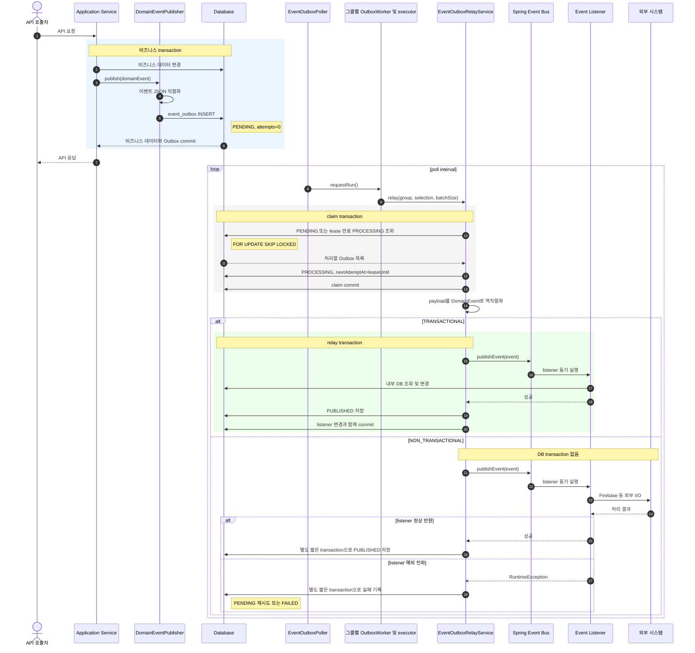
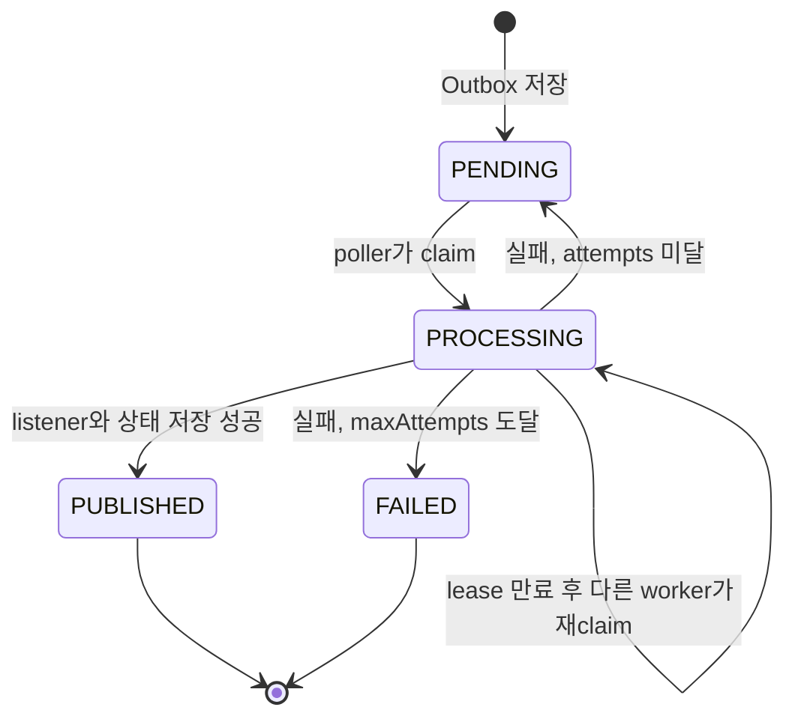

# Event Outbox 발행 및 소비 흐름

이 문서는 `DomainEventPublisher`로 발행한 이벤트가 공용 `event_outbox`에 저장되고 listener가 소비할
때까지의 실행 흐름과 `OutboxDispatchMode` 선택 기준을 설명한다.

## 전체 흐름

## 상태 전이

재시도 중인 이벤트의 상태는 `FAILED`가 아니라 `PENDING`이다. 실패할 때마다 `attempts`와
`lastError`를 기록하고, 백오프를 적용한 `nextAttemptAt` 이후 다시 처리한다. `maxAttempts`에 도달한
경우에만 `FAILED`가 되며 자동 재시도 대상에서 제외된다.

## Dispatch mode 선택 기준

`OutboxDispatchMode`는 최초 Outbox 저장의 transaction 여부가 아니다. Outbox를 claim한 relay가
listener를 어느 transaction 경계에서 실행할지 정한다.

| 이벤트가 요구하는 작업 | 권장 mode | 이유 |
| --- | --- | --- |
| 내부 DB 조회·변경과 후속 Outbox 저장 | `TRANSACTIONAL` | listener 변경과 현재 Outbox의 `PUBLISHED` 저장을 원자적으로 commit 또는 rollback한다. |
| Firebase, SMTP, 외부 webhook 등 네트워크 I/O | `NON_TRANSACTIONAL` | 외부 응답 대기 중 JDBC connection과 긴 DB transaction을 점유하지 않는다. |
| 내부 DB 작업과 외부 I/O가 혼합된 작업 | 이벤트를 두 단계로 분리 | 내부 준비 이벤트는 `TRANSACTIONAL`, 외부 실행 이벤트는 `NON_TRANSACTIONAL`로 분리한다. |

FCM 흐름이라면 대상과 token을 조회하고 batch Outbox를 만드는 요청 이벤트는 `TRANSACTIONAL`, 실제
Firebase API를 호출하는 batch 발송 이벤트는 `NON_TRANSACTIONAL`이 적절하다.

## 실패와 재시도 조건

“이벤트가 요구한 행동이 실패하면 재시도한다”는 설명은 listener가 실패를 예외로 relay까지 전파할 때만
성립한다.

| 상황 | Outbox 결과 | 주의사항 |
| --- | --- | --- |
| listener가 `RuntimeException`을 던짐 | `PENDING` 재시도, 최대 횟수 도달 시 `FAILED` | relay가 예외를 관찰할 수 있어야 한다. |
| 외부 API가 부분 실패를 반환했지만 listener가 정상 반환 | `PUBLISHED` | 실패 token을 결과값으로만 삼키면 자동 재시도되지 않는다. |
| `NON_TRANSACTIONAL` 외부 호출은 성공했지만 `PUBLISHED` 저장 실패 | lease 만료 후 재시도 가능 | 외부 side effect가 중복 실행될 수 있으므로 consumer 멱등성이 필요하다. |
| worker가 `PROCESSING` 중 종료 | lease 만료 후 재claim | 다른 worker가 같은 이벤트를 이어서 처리한다. |

`NON_TRANSACTIONAL` listener는 일반 `@EventListener`로 동기 실행해야 예외가 relay까지 전달된다.
`@Async` listener는 relay가 완료와 실패를 관찰할 수 없고, transaction이 없는 상태의
`@TransactionalEventListener`는 `fallbackExecution = true`가 없으면 실행되지 않는다.

## 운영 제어

`EVENT_OUTBOX_RELAY_ENABLED=false`는 poller만 중지한다. `DomainEventPublisher`는 계속 신규 이벤트를
`PENDING`으로 저장하며, relay를 다시 활성화하면 적체된 이벤트를 처리한다. Spring local publisher로
우회하지 않으므로 환경에 따라 이벤트 내구성이 달라지지 않는다.

## 처리 그룹과 실행 격리

`event_outbox` 테이블은 공용으로 유지한다. `OutboxRoutingConfig`의 분류를
`OutboxEventRoutingPolicy`가 해석하며, 최초 저장 시 분류 결과를 `processing_group`에 기록한다.
선점과 적체 집계는 저장된 그룹을 동등 조건으로 조회한다.
`PENDING`, `PROCESSING`만 포함하는 `(processing_group, next_attempt_at, id)` 부분 인덱스로
해당 그룹 안에서 시간순으로 탐색하므로 다른 그룹의 적체를 필터링하며 읽지 않는다.
정확한 이벤트 타입 매핑이 기본 접두사 규칙보다 우선한다.

- REALTIME: 기본 `chat.` 이벤트, Community의 updated/deleted/invited/member.left/member.kicked 이벤트.
- BACKGROUND: 알림용 `community.thread.message.created`, mentioned, FCM 및 나머지 미등록 이벤트.

두 그룹은 같은 Worker 구현과 Relay 코드를 사용하지만 Worker 상태와 executor를 공유하지 않는다.
`workers.<group>.concurrency`(REALTIME 기본 3, BACKGROUND 기본 2)가 그룹별 실행 슬롯 수와 executor의 core/max 및 큐 용량을 함께 결정한다.
각 슬롯은 같은 그룹의 별도 배치를 병렬 선점하며 선점 이전에는 DB row를 보관하지 않는다.
trace context는 각 실행으로 전파한다.
폴러는 실행 요청만 전달하고 실제 DB 선점부터 발행·완료 기록까지 전용 executor에서 수행한다.
한 번의 요청은 모든 슬롯을 깨운다. 반복 요청은 슬롯마다 하나의 후속 신호로 합친다.
후속 신호가 없으면 각 슬롯은 한 배치 이후 종료하고 다음 폴링을 기다린다.
executor 거절이나 배치 예외 뒤에도 다음 polling에서 다시 시도한다.
종료 시 새 선점을 중지하며 executor 종료 대기는 30초다. 강제 종료로 남은 PROCESSING은 lease 만료 후 복구한다.

공통 `poll-interval-ms`와 `batch-size`는 기본값이며 `workers.realtime`과 `workers.background`에서
각각 덮어쓸 수 있다. 폴링 주기는 Worker 완료 시각이 아니라 짧은 실행 요청 메서드 반환을 기준으로 한다.
`relay-enabled=false`는 두 폴링을 중지하지만 publisher의 저장은 계속된다.

새 이벤트는 기존 그룹이면 라우팅 설정을 수정한다. 라우팅 규칙 변경은 이후 저장되는 이벤트부터 적용되며,
기존 미완료 이벤트도 재분류하려면 relay를 중지하고 별도 데이터 마이그레이션을 수행한다.
순차 배포 중 그룹을 보내지 않는 구버전 writer를 위해 `assign_event_outbox_processing_group` 트리거가
현재 기본 분류를 적용하므로, 규칙 변경 시 이 함수도 함께 갱신한다.
구버전 writer가 모두 제거된 뒤 트리거 제거는 별도 마이그레이션으로 진행할 수 있다. 새 그룹이 필요하면 라우팅 등록과 함께
Worker·전용 executor·폴링 등록을 추가한다. 그룹 등록만으로 Worker가 자동 생성되지는 않는다.
각 그룹은 고유한 이름을 사용하며 선점과 적체 집계는 같은 `processing_group` 조건을 사용한다.

## 관측 지표

| 이름 | 태그 | 의미 |
| --- | --- | --- |
| `event.outbox.batch.duration` | group, outcome | 선점부터 배치 종료까지. success는 루프 종료이며 개별 이벤트 성공을 뜻하지 않는다. |
| `event.outbox.publish.duration` | group, outcome | 이벤트 복원·리스너 실행·상태 저장 시간. 실패 및 소유권 상실도 별도 표본으로 기록한다. |
| `event.outbox.group.failure` | group, outcome=retry/failed | 실패 상태 저장에 성공한 이벤트 수 |
| `event.outbox.worker.rejected` | group | executor 실행 요청 거절 수. 종료된 Worker에 대한 요청은 제외한다. |
| `event.outbox.backlog` | group, status=pending/processing | 재시도 대기와 만료 전 lease를 포함하는 미완료 건수 |
| `event.outbox.oldest.age` | group | 미완료 이벤트 중 가장 오래된 created_at부터 수집 시각까지의 초 |
| `event.outbox.backlog.sample.timestamp` | group | 마지막 성공 수집의 Unix 시각(초). 초기값 0은 아직 미수집이다. |
| `event.outbox.backlog.sample.failure` | group | 적체 집계 실패 수 |

기존 태그 없는 `event.outbox.relay.retry/failed`는 호환성을 위해 유지한다.
적체는 기본 30초마다 DB에서 그룹별 집계하며 scrape 시 DB 조회를 실행하지 않는다.
PUBLISHED와 FAILED는 backlog에서 제외한다. oldest age는 재시도 대기와 처리 중 시간도 포함하며 순수 폴링 대기가 아니다.
수집 실패 시 이전 값과 시각을 유지하므로 sample timestamp와 실패 counter를 함께 확인한다.
`metrics.enabled=false`로 집계를 중지할 수 있으며 relay 중지와 독립적이다.
DB 전체의 값이므로 다중 인스턴스의 backlog를 합산하지 않는다. 처리 counter는 인스턴스별 값이다.
Timer percentile histogram은 배포 환경의 Micrometer distribution 설정으로 활성화하여 p95/p99를 비교한다.
집계 비용은 실제 데이터 규모에서 실행계획으로 확인하고 수집 주기를 조절한다.

## 배포와 복구

구버전 폴러는 그룹 구분 없이 선점하므로 rolling deploy 중에는 실행 격리가 보장되지 않는다.

1. 모든 인스턴스의 기존 relay를 중지하고 실행 중인 배치가 종료되었는지 확인한다.
2. `V2026.10.23.00.00__add_event_outbox_processing_group.sql`을 먼저 적용한다.
   기존 데이터 분류와 인덱스 생성을 수행하므로 테이블 크기에 따른 잠금·실행 시간을 사전 확인한다.
   구버전 writer도 트리거로 분류되고 기존 시간순 인덱스는 유지되어 롤백할 수 있다.
3. 새 코드를 relay 비활성 상태로 배포한다. 업무 요청의 Outbox 적재는 유지한다.
4. 라우팅 목록과 그룹별 미처리 이벤트를 확인한 뒤 새 인스턴스에서 relay를 활성화한다.
5. backlog/oldest age, 재시도/FAILED, 채팅 전달 지연을 확인한다.

롤백도 신규 Worker 중지와 배치 종료 확인 후 구버전 relay를 활성화한다.
강제 중단된 배치는 최대 5분 lease 대기가 생길 수 있으며 상태를 임의로 PUBLISHED로 바꾸지 않는다.
FAILED는 자동 재시도되지 않으므로 원인 해결·외부 발송 여부 확인 후 별도 운영 절차로 복구한다.

이번 변경은 처리 격리이며 즉시 wake-up이나 방별 순서를 보장하지 않는다.
여러 인스턴스·실패 재시도에서는 완료 순서가 달라질 수 있다.
발송 성공 후 상태 저장 전 중단되면 중복 발송이 가능하고, WebSocket 전송 성공이 실제 사용자 수신을 뜻하지 않는다.
클라이언트 중복 제거·누락 복구와 FCM 중복 정책은 각각의 소비 경로에서 관리한다.

### 그룹별 병렬 처리 설정

- `EVENT_OUTBOX_REALTIME_CONCURRENCY`: 실시간 그룹 동시 배치 수(기본 3).
- `EVENT_OUTBOX_BACKGROUND_CONCURRENCY`: 백그라운드 그룹 동시 배치 수(기본 2).

양수만 허용하며 0 이하는 애플리케이션 시작 시 거부한다. 일부 슬롯의 executor 등록이 거절되어도
다른 슬롯은 실행하고, 거절된 슬롯은 다음 요청에 재등록한다. requestRun의 true는 하나 이상의
슬롯이 요청을 수락했음을 뜻하며 모든 슬롯의 실행·발행 성공을 보장하지 않는다.
종료 시 실행 중인 배치는 완료하도록 두고 모든 슬롯의 추가 선점을 막는다.

그룹당 최대 선점 건수는 대략 concurrency × batch-size다. 각 슬롯의 lease는 독립적으로 시작한다.
DB 커넥션 여유, 외부 API 허용 호출량, 처리 시간과 oldest age를 확인하며 값을 조정한다.
스레드 수가 늘어나도 동일 방 이벤트의 순서나 외부 발송의 중복 방지는 자동 보장되지 않는다.
배포 인스턴스 수만큼 전체 동시성이 증가하므로 그룹별 서버 전체 호출량도 함께 확인한다.

현재 동시성은 초기 운영값으로 설정한 REALTIME 3, BACKGROUND 2이며 부하 측정으로 산정한 최적값은 아니다.
채팅팀과 알림팀은 각 그룹의 부하테스트로 전달 지연·처리량·실패율·backlog·oldest age를 확인하고
환경변수로 크기를 조정한다. DB와 CPU는 공유하므로 두 그룹의 혼합 부하와 배포 인스턴스 수도 함께 검증한다.
